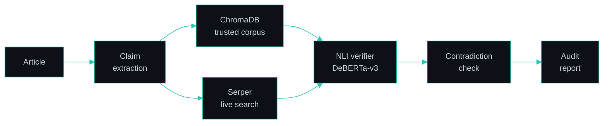

<div align="center">


<a href="https://github.com/Deepika6689">

</a>


[](https://linkedin.com/in/deepika-sajjan-22a041284/)
[](mailto:deepikasajjan6689@gmail.com)
[](https://github.com/Deepika6689)

</div>

<br/>

## `$ whoami`

```python
class Deepika:
    role      = ["AI Engineer", "Software Engineer"]   # dual-core, one brain
    degree    = "B.E. AI & ML · PDA College of Engineering · 2026"
    base      = "Karnataka, India"
    open_to   = ["AI Engineer (fresher)", "Full Stack / SDE (fresher)"]
    locations = ["Bengaluru", "Hyderabad", "Remote (India)"]

    def superpower(self):
        return "takes a messy idea and ships it as a working, deployed system"

    def philosophy(self):
        return "don't ask an LLM if it's true, make it show the evidence"
```

<br/>

## ⚡ Dual-Core Engineer

<table>
<tr>
<td width="50%" valign="top">

### 🧠 AI Core
- Agents & orchestration with **LangGraph / LangChain**
- **RAG** pipelines, hybrid search, vector stores (**ChromaDB**)
- **NLI-based verification** instead of vibes-based LLM answers
- **Computer vision** with TensorFlow, Keras and OpenCV
- Guardrails & hallucination detection for LLM apps

</td>
<td width="50%" valign="top">

### 🛠️ Software Core
- Backends with **Django**, **FastAPI**, REST APIs
- **React + TypeScript + Vite** frontends
- **MySQL / SQLite** schema and query design
- **Docker**, Git/GitHub, Netlify deployments
- Role-based apps: user and admin portals, auth, workflows

</td>
</tr>
</table>

<br/>

## 🏅 Status Board

| | |
| :-- | :-- |
| 💼 **Now** | Software Development Intern @ **Pentagon Space**, Bengaluru (Jan 2026 – present) |
| 🏆 **Recognition** | Selected for **NAIN**, a government-backed incubation program, for stored-grain pest detection |
| 🔭 **Focus** | Production-style RAG, agent workflows, and LLM reliability |

<br/>

## 🚀 Featured Builds

### 🛡️ [AI Misinformation Audit Agent](https://github.com/Deepika6689/misinfoagent-project)
`LangGraph` `LangChain` `ChromaDB` `DeBERTa-v3 NLI` `FastAPI` `Docker`

Reads an article **claim by claim**, gathers evidence, and returns a structured credibility report.



- Two evidence sources: trusted corpus + live web search for recent claims
- A dedicated NLI model labels each claim **Supported / Refuted / Not Enough Info**, so verdicts are narrow and auditable
- Claims are cross-checked against each other to flag self-contradicting articles

<br/>

### 🔎 [RAG Pipeline with Hybrid Search](https://github.com/Deepika6689/rag-pipeline-hybrid-search)
`LangChain` `Hybrid retrieval` `Vector store`

Retrieval that combines keyword and semantic search, built to go beyond a basic "chat with your docs" demo.

<br/>

### 🗄️ Text-to-SQL Interface
`LLM` `MySQL` `Guardrails`

Natural language to SQL against a Zomato database, with **guardrails and hallucination detection** so bad queries get caught before they run.

<br/>

### 📝 Agentic Docx Builder
`FastAPI` `Groq` `Agents`

An autonomous agent that plans and writes full documents on its own.

<br/>

### 🌾 Stored-Grain Insect & Pest Detection · NAIN
`Python` `OpenCV` `Tkinter` `SQLite`

Real-time insect detection for grain storage monitoring, with a desktop GUI and SQLite-backed records.

<br/>

### 💳 [Loan Management System](https://github.com/Deepika6689/loan-project)
`Django` `MySQL` `HTML/CSS/JS`

Full-stack platform with separate user and admin portals: loan applications, approval workflow, EMI tracking, analytics dashboard and secure auth. Built end to end during my internship.

<br/>

### 🌿 [Smart AgroVision: Plant Disease Detection](https://github.com/Deepika6689/Smart-AgroVision)
`TensorFlow` `React` `TypeScript` `Vite`

33-class CNN leaf-disease classifier, rebuilt as a React web app that returns severity, causes, symptoms and treatments. [Live demo](https://jovial-phoenix-7c8303.netlify.app/)

<br/>

## 🧰 Tech Stack

<table>
<tr>
<td width="25%"><b>Languages</b></td>
<td></td>
</tr>
<tr>
<td><b>ML & Vision</b></td>
<td>&nbsp; <sub>Keras · NumPy</sub></td>
</tr>
<tr>
<td><b>GenAI</b></td>
<td><sub>LangGraph · LangChain · RAG · Hybrid Search · ChromaDB · NLI · Groq</sub></td>
</tr>
<tr>
<td><b>Backend & Data</b></td>
<td>&nbsp; <sub>REST APIs</sub></td>
</tr>
<tr>
<td><b>Frontend</b></td>
<td></td>
</tr>
<tr>
<td><b>Tools</b></td>
<td></td>
</tr>
</table>

<br/>

## 🎓 Education & Certifications

**B.E. in Artificial Intelligence & Machine Learning** · PDA College of Engineering, Kalaburagi · 2022 – 2026 · CGPA 8.0

| Certification | Issuer | Date |
| :-- | :-- | :-- |
| Python with Data Science | Ethnotech Academic Solutions Pvt. Ltd. | Jun 2025 |
| Complete Python with DSA & LeetCode | Udemy | Sep 2025 |
| Advanced Programming in C | Cisco Networking Academy | Feb 2024 |

<br/>

## 📊 GitHub Stats

<div align="center">


</div>

<br/>

## 🛰️ Currently

| 📚 Learning | 🔨 Building | ⏭️ Next |
| :-- | :-- | :-- |
| Advanced LangGraph and agent patterns | Reliable, evidence-grounded LLM systems | Agent orchestration project + fine-tuning |

<br/>

<div align="center">

### 🤝 Let's build something

If you're hiring for **AI Engineer** or **SDE** fresher roles, or just want to talk agents, RAG or full-stack, my inbox is open.

[](https://linkedin.com/in/deepika-sajjan-22a041284/)
[](mailto:deepikasajjan6689@gmail.com)


</div>
