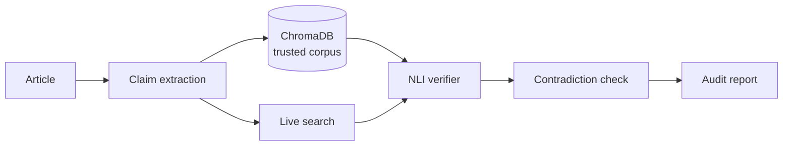

# Hi, I'm Deepika Sajjan 👋

### AI Engineer · Software Engineer

B.E. in AI & ML (Class of 2026). I build the model or agent that does the thinking, and the backend and UI that make it usable.

[LinkedIn](https://linkedin.com/in/deepika-sajjan-22a041284/) · [Email](mailto:deepikasajjan6689@gmail.com) · [Live demo](https://jovial-phoenix-7c8303.netlify.app/)

---

## About

I like taking a project from idea to a deployed system, and I care about LLM output that can be **checked**, not just trusted.

| | |
| :-- | :-- |
| **Now** | Software Development Intern, Pentagon Space, Bengaluru (Jan 2026 – present) |
| **Recognition** | Selected for **NAIN**, a government-backed incubation program |
| **Open to** | AI Engineer and Full Stack / SDE fresher roles · Bengaluru, Hyderabad, Remote (India) |

---

## Contribution graph

<picture>
  <source media="(prefers-color-scheme: dark)" srcset="https://raw.githubusercontent.com/Deepika6689/Deepika6689/output/snake-dark.svg" />
  <source media="(prefers-color-scheme: light)" srcset="https://raw.githubusercontent.com/Deepika6689/Deepika6689/output/snake.svg" />
  
</picture>

<picture>
  <source media="(prefers-color-scheme: dark)" srcset="./profile-3d-contrib/profile-night-rainbow.svg">
  <source media="(prefers-color-scheme: light)" srcset="./profile-3d-contrib/profile-season.svg">
  
</picture>

---

## What I work on

| AI engineering | Software engineering |
| :-- | :-- |
| Agents with LangGraph and LangChain | Backends with Django, FastAPI, REST APIs |
| RAG pipelines, hybrid search, ChromaDB | React + TypeScript frontends |
| NLI-based claim verification | MySQL and SQLite design |
| Computer vision (TensorFlow, Keras, OpenCV) | Docker, Git, Netlify |
| Guardrails and hallucination detection | Auth, role-based portals, workflows |

---

## Selected work

### 🛡️ [AI Misinformation Audit Agent](https://github.com/Deepika6689/misinfoagent-project)
`LangGraph` `LangChain` `ChromaDB` `DeBERTa-v3` `FastAPI` `Docker`

Reads an article claim by claim, gathers evidence, and returns a credibility report. A dedicated NLI model labels each claim **Supported / Refuted / Not Enough Info**, so verdicts are auditable instead of an LLM's "is this true?" guess. It also flags articles that contradict themselves.

### More projects

| Project | What it does | Stack |
| :-- | :-- | :-- |
| [RAG with Hybrid Search](https://github.com/Deepika6689/rag-pipeline-hybrid-search) | Keyword + semantic retrieval over documents | LangChain, vector store |
| Text-to-SQL Interface | Natural language to SQL with guardrails and hallucination detection | LLM, MySQL |
| Agentic Docx Builder | Autonomous agent that plans and writes full documents | FastAPI, Groq |
| Stored-Grain Pest Detection (NAIN) | Real-time insect detection with a monitoring desktop app | OpenCV, Tkinter, SQLite |
| [Loan Management System](https://github.com/Deepika6689/loan-project) | User and admin portals, approvals, EMI tracking, analytics | Django, MySQL |
| [Smart AgroVision](https://github.com/Deepika6689/Smart-AgroVision) | 33-class plant disease classifier with a deployed web app | TensorFlow, React, TypeScript |

---

## Tech stack

Also: LangGraph · RAG · ChromaDB · Keras · NumPy · REST APIs

---

## Education

**B.E. in Artificial Intelligence & Machine Learning** · PDA College of Engineering, Kalaburagi · 2022 – 2026 · CGPA 8.0

**Certifications:** Python with Data Science (Ethnotech, Jun 2025) · Complete Python with DSA & LeetCode (Udemy, Sep 2025) · Advanced Programming in C (Cisco Networking Academy, Feb 2024)

---

## Currently

Advanced LangGraph and agent patterns · making LLM systems reliable and evidence-grounded · next: an agent orchestration project, then fine-tuning.

---

**Hiring for AI Engineer or SDE fresher roles? Let's talk:** [LinkedIn](https://linkedin.com/in/deepika-sajjan-22a041284/) · [deepikasajjan6689@gmail.com](mailto:deepikasajjan6689@gmail.com)
