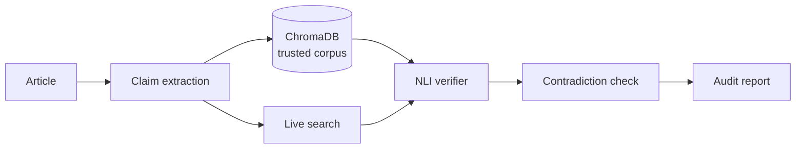

### I build LLM systems that show their evidence, and the full-stack apps around them.

 

## 👩‍💻 At a glance

| | |
| :-- | :-- |
| **💼 Now** | Software Development Intern · **Pentagon Space**, Bengaluru (Jan 2026 – present) |
| **🏅 Recognition** | Selected for **NAIN**, a government-backed incubation program |
| **🎓 Education** | B.E. in AI & ML · PDA College of Engineering · CGPA 8.0 |
| **🎯 Looking for** | AI Engineer and Full Stack / SDE fresher roles |

 

## 🧰 Tech stack

**AI / ML**

**Backend & Data**

**Frontend**

**Tools**

 

## 🚀 Featured project

### 🛡️ AI Misinformation Audit Agent

Reads an article **claim by claim**, gathers evidence from a trusted corpus and live search, and returns a credibility report. A dedicated NLI model labels each claim **Supported / Refuted / Not Enough Info**, so every verdict is auditable. Articles that contradict themselves get flagged.

 

## 🛠️ More projects

<table>
<tr>
<td width="50%" valign="top">

### 🔎 RAG with Hybrid Search
Keyword + semantic retrieval over documents.

</td>
<td width="50%" valign="top">

### 💳 Loan Management System
User and admin portals, approval workflow, EMI tracking and analytics dashboard.

</td>
</tr>
<tr>
<td width="50%" valign="top">

### 🌿 Smart AgroVision
33-class plant disease classifier with severity, causes, symptoms and treatments.

 

</td>
<td width="50%" valign="top">

### 🌾 Stored-Grain Pest Detection
Real-time insect detection for grain storage. Selected for **NAIN**.

</td>
</tr>
<tr>
<td width="50%" valign="top">

### 🗄️ Text-to-SQL Interface
Natural language to SQL with guardrails and hallucination detection.

</td>
<td width="50%" valign="top">

### 📝 Agentic Docx Builder
Autonomous agent that plans and writes full documents.

</td>
</tr>
</table>

 

## 📚 Education & certifications

**B.E. in Artificial Intelligence & Machine Learning** · PDA College of Engineering, Kalaburagi · 2022 – 2026 · CGPA 8.0

| Certification | Issuer | Date |
| :-- | :-- | :-- |
| Python with Data Science | Ethnotech Academic Solutions | Jun 2025 |
| Complete Python with DSA & LeetCode | Udemy | Sep 2025 |
| Advanced Programming in C | Cisco Networking Academy | Feb 2024 |

 

## 🔭 Currently

| 📚 Learning | 🔨 Building | ⏭️ Next |
| :-- | :-- | :-- |
| Advanced LangGraph and agent patterns | Reliable, evidence-grounded LLM systems | Agent orchestration project, then fine-tuning |

 

### 🤝 Let's build something together

