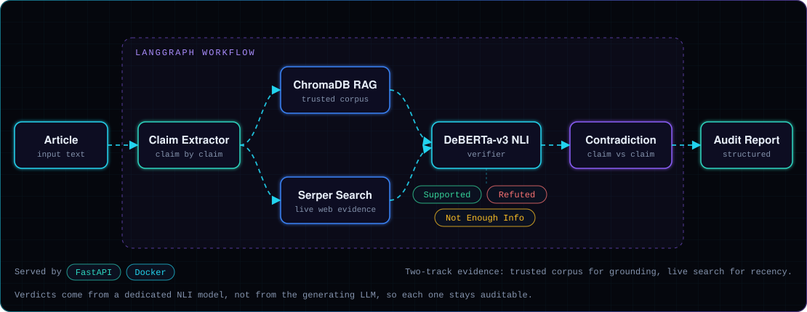
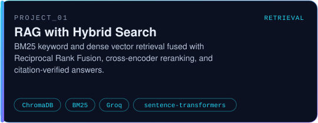
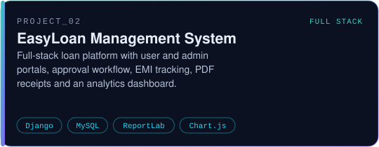
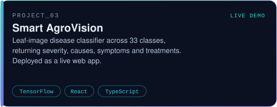
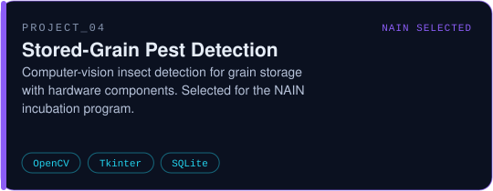
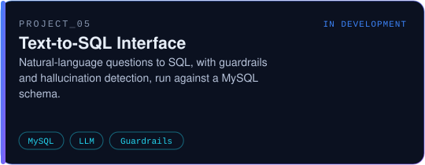
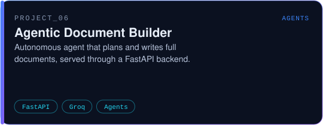
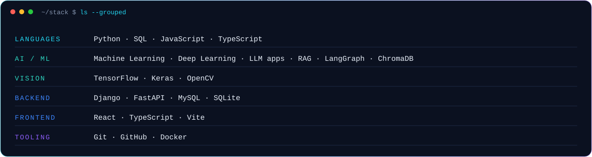

<div align="center">



<br/>

<a href="https://github.com/Deepika6689"></a>&nbsp;
<a href="https://linkedin.com/in/deepika-sajjan-22a041284/"></a>&nbsp;
<a href="mailto:deepikasajjan6689@gmail.com"></a>

</div>


```yaml
name:       Deepika Sajjan
education:  B.E. Artificial Intelligence & Machine Learning, 2026
            PDA College of Engineering, Kalaburagi (CGPA 8.0)
experience: Software Development Intern, Pentagon Space, Bengaluru
recognition: Selected for NAIN, a government-backed incubation program
status:     Recent graduate, open to full-time roles
base:       Bengaluru · Hyderabad · Remote
learning:   Advanced LangGraph and agent patterns
building:   Reliable, evidence-grounded LLM systems
```

I build **LLM systems that show their evidence** and the **full-stack software** around them. On the AI side that means retrieval, agents and verification. On the software side, Python backends, databases and React front ends.

**Open to:** Software Engineer · Python Developer · AI / Applied AI Engineer · Entry-level Full Stack Developer


## AI Misinformation Audit Agent

Reads an article **claim by claim**, gathers evidence from a trusted corpus and from live search, and labels each claim **Supported**, **Refuted** or **Not Enough Info** with a dedicated NLI model. It also flags claims that contradict *each other* inside the same article.



- **Claim-level verdicts.** One fabricated statistic gets flagged instead of disappearing into an overall "looks fine".
- **Two-track evidence.** The local corpus anchors trust, and live search covers recent events.
- **Auditable by design.** DeBERTa-v3 NLI makes the call, not the LLM that wrote the report.

`LangGraph` `ChromaDB` `DeBERTa-v3 NLI` `Serper` `FastAPI` `Docker`

**[Source code on GitHub →](https://github.com/Deepika6689/misinfoagent-project)**


<table>
<tr>
<td width="50%" valign="top">
<a href="https://github.com/Deepika6689/rag-pipeline-hybrid-search"></a>
<sub><a href="https://github.com/Deepika6689/rag-pipeline-hybrid-search">Repository</a></sub>
</td>
<td width="50%" valign="top">
<a href="https://github.com/Deepika6689/loan-project"></a>
<sub><a href="https://github.com/Deepika6689/loan-project">Repository</a></sub>
</td>
</tr>
<tr>
<td width="50%" valign="top">
<a href="https://github.com/Deepika6689/Smart-AgroVision"></a>
<sub><a href="https://github.com/Deepika6689/Smart-AgroVision">Repository</a> · <a href="https://jovial-phoenix-7c8303.netlify.app/">Live demo</a> · <a href="https://github.com/Deepika6689/plant-disease-detection">Original model</a></sub>
</td>
<td width="50%" valign="top">

<sub>Government-backed NAIN incubation</sub>
</td>
</tr>
<tr>
<td width="50%" valign="top">

<sub>In development</sub>
</td>
<td width="50%" valign="top">

<sub>Agent workflow</sub>
</td>
</tr>
</table>




<sub>**Certifications:** Python with Data Science (Ethnotech Academic Solutions, 2025) · Complete Python with DSA & LeetCode (Udemy, 2025) · Advanced Programming in C (Cisco Networking Academy, 2024)</sub>


<div align="center">

**Hiring for AI or software roles? Let's talk.**

<a href="https://linkedin.com/in/deepika-sajjan-22a041284/"></a>&nbsp;
<a href="mailto:deepikasajjan6689@gmail.com"></a>

<br/>


</div>
